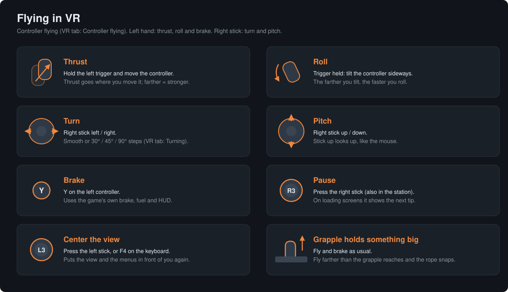
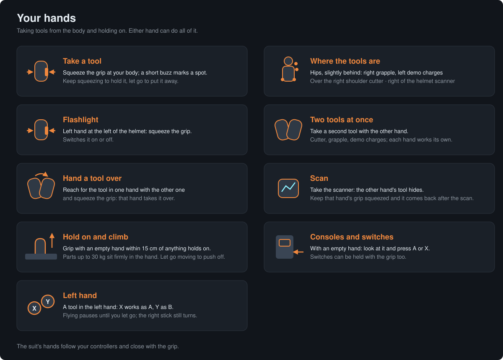
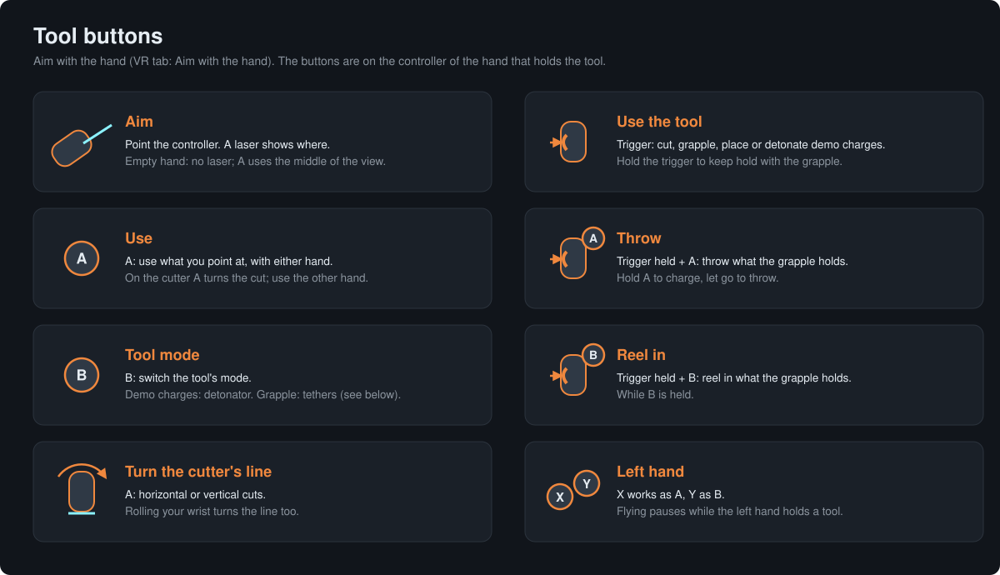
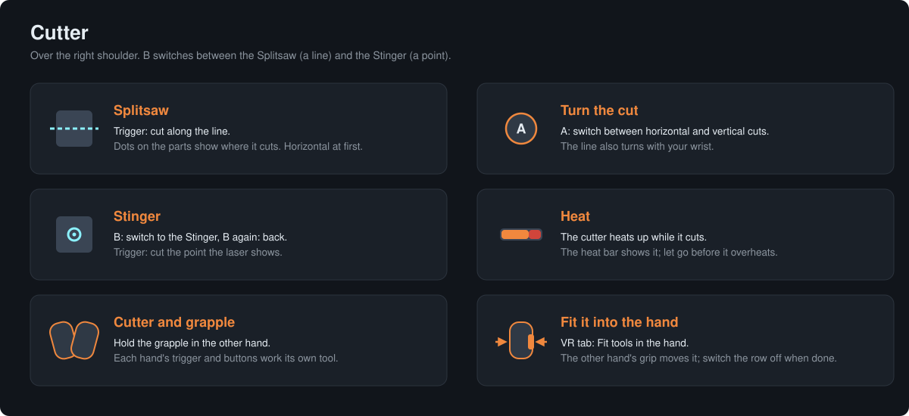
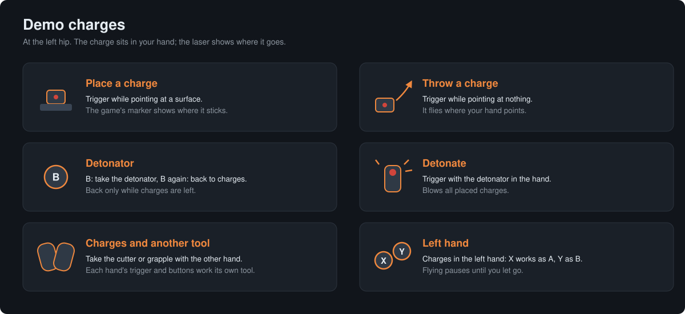
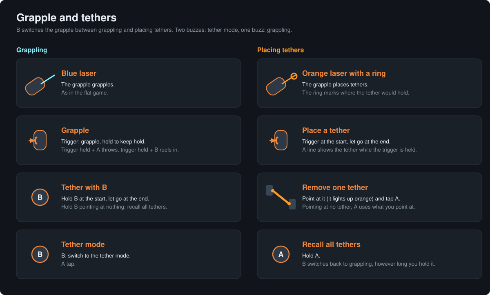
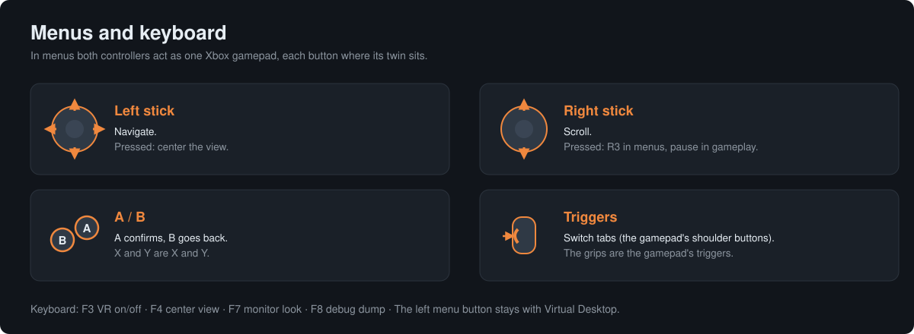

# Installing ShipbreakerVR (test build)

## Requirements
- Hardspace: Shipbreaker (Steam, version 1.3.x) on Windows
- A PC VR headset with an active OpenXR runtime (Meta Quest via Virtual Desktop, Quest Link/Air Link, SteamVR, …)

## Install
By installing you accept the [disclaimer](../DISCLAIMER.md). Back up your save games first.

1. In Steam: right-click Hardspace: Shipbreaker → Manage → Browse local files.
2. Extract the whole release ZIP into that folder (where `Shipbreaker.exe` is). Merge folders, overwrite files.
3. Start the game. The first start takes a bit longer while BepInEx sets itself up.

## Use
- Connect the headset and start the game; VR starts right away. **F3** toggles VR.
- **F4** (or pressing the **left stick** on the controllers) recenters the view on the headset: position, and in menus also view direction and the menu canvas.
  Menus always appear at eye height, also when you look up or down.
  The row "Center view" at the top of the VR tab does the same.
- **F7** at one of the station's monitors switches its screen look.
- For bug reports, set `Diagnose = true` under `[Debug]` in `BepInEx\config\de.marczahn.shipbreakervr.cfg`. Then
  **F8** writes what is drawn around you into the log, and load screens and frame times are logged too. With
  `WerkzeugExport = true`, **Shift+F8** saves the model of the tool in your hand (textures, mesh, UV layout) to
  `BepInEx\ShipbreakerVR-tools`, for modding work.
- The keys can be changed under `[Tasten]` in the config file, for example `AnsichtZentrieren = F9` or
  `VrAnAus = F3 + LeftControl`.
- The station between shifts has its own render resolution, the row "Station resolution" in the VR tab. If the view wobbles
  slightly at the monitors when you move your head, the graphics card misses the headset's frame rate there; lower it
  until that stops.
- If your view sits too low or off to one side in the suit, move it with the rows "Head height" and "Head sideways" in
  the VR tab (up to 10 cm each way). The helmet stays put; only your eyes move inside it.
- Settings: in the game's options (tab "VR") or in
  `BepInEx\config\de.marczahn.shipbreakervr.cfg`.

### Flying with the controllers

Switch it in the options row "Controller flying" in the VR tab. Hold the left trigger, then:
- move the controller away from where it was when you pressed it to fly that way,
- tilt it sideways to roll; the further, the faster.

Thrust starts 2 cm away from that point and is full at 10 cm. The rows "Thrust deadzone" and "Full thrust at" change
both; full thrust always stays at least 5 cm beyond the deadzone.

The right stick turns (left/right) and pitches (up/down), the further, the faster; it needs no trigger. The row "Turning"
switches turning to steps of 30, 45 or 90 degrees per flick. Y brakes. Pressing the right stick opens the pause menu
(also in the station), pressing the left stick recenters the view. Mouse, keyboard and gamepad keep working.

While the grapple holds something heavy, the flat game stops thrust and brake and lets you swing on the rope instead.
With controller flying you keep flying and braking as usual; the rope keeps pulling, and it snaps if you fly farther
away than the grapple reaches.

A small globe at the bottom of the visor shows where the left controller is while you hold the trigger: its center is
where you pressed it, its surface full thrust, the small inner globe the deadzone, and a small cross in it moves and turns with your hand. The row
"Flight globe" shows it always, only while flying, or never.

### Tools in the hand

With the row "Aim with the hand" in the VR tab on (the default), the tools aim where the controller that holds them
points, from the tool's muzzle. A thin laser shows where; the crosshair in the middle of the view is hidden meanwhile.
With an empty hand there is no laser: A uses what is in the middle of your view, marked by the game's dot, as in the
flat game.
- Squeeze the grip at your body to take a tool: grapple at the right hip, demo charges at the left hip, cutter over the
  right shoulder, scanner at the right side of the helmet. The controller buzzes when it is in such a spot. The left
  hand at the left side of the helmet switches the flashlight on or off with the grip. Keep the
  grip squeezed to hold the tool; let go to put it away.
- Each hand can hold a tool, so two of the cutter, the grapple and the demo charges can be out at once; each hand's
  trigger and buttons work its own tool. Every tool exists only once: reaching for the tool in one hand with the other
  one hands it over. The scanner hides the other hand's tool while you scan; keep that hand's grip squeezed and its tool
  comes back when you let go of the scanner. The row "Two tools at once" in the VR tab switches this off, so a tool taken
  with one hand replaces the one in the other hand.
- On the controller that holds the tool: trigger = use the tool (cut, grapple, place or detonate demo charges), A =
  use what you point at (A or X works from either hand, also an empty one), trigger + A = throw, B = switch the tool's
  mode, trigger + B = reel in. In the left hand X and Y stand for A and B, and controller flying pauses until you let
  go; the right stick still turns. The grapple's tethers are below.
- The cutter's line starts out horizontal. A on the cutter switches between horizontal and vertical cuts (the right
  mouse button in the flat game), and the line also turns with your wrist. That hand's A then does not use things;
  the other hand's A or X does.
- The suit's hands follow your controllers and close while you squeeze the grip.
- The flat game never showed the cutter's right side, which is coarse and plain. The mod copies the detailed left side
  onto it, mirrored (small print there reads backwards). `CutterSpiegeln = false` under `[Bild]` in the config file
  switches this off.
- If the cutter or the grapple does not sit right in your hand, switch on "Fit tools in the hand" in the VR tab. While
  one hand holds the tool, squeeze the grip of the other hand at the tool to grab it, then move and turn it into place;
  letting go stores it, separately for each tool and hand. Switch the row off again when you are done (while it is on,
  the other hand does not take tools from the body). The values are in `BepInEx\config\de.marczahn.shipbreakervr.cfg`
  under `[Justierung]`; delete one to get its default back.

### Cutter and demo charges

- Cutter: the trigger cuts, A switches the Splitsaw between horizontal and vertical cuts (the line also turns with your
  wrist), B switches between the Splitsaw (a line) and the Stinger (the point the laser shows). A bright dot marks
  where the laser hits; with the Splitsaw, small dots on the parts show where the cut goes.
- Demo charges: the trigger places a charge where you point, or throws it where your hand points if you point at
  nothing. B takes the detonator (and goes back to the charges while you have some left); with the detonator the
  trigger detonates.

### Grapple and tethers

B switches the grapple between two modes. The controller buzzes twice when the tether mode starts and once when
grappling comes back.
- Grappling (red laser, a bright dot where it hits): the trigger grapples, as in the flat game. B only switches to
  the tether mode, however long you hold it; tethers are placed and recalled there.
- Placing tethers (orange laser, a ring where it points): pull the trigger at the start of the tether and let go at
  the end; a line shows the tether meanwhile. The tether you point at lights up orange, and a tap on A removes it;
  pointing at no tether, A uses what you point at. Hold A to recall all tethers. B switches back to grappling however
  long you hold it.

### Holding on and climbing
Squeeze the grip of a hand that holds no tool close to anything: the hand holds on right there. Move the hand to pull
yourself along it, hand over hand with both hands, or with one hand while the other works a tool. Who moves depends on
the masses: the station, fixed hulls and anything too heavy for the game's own grab stay put, light parts come to your
hand instead. Let go while the hand moves to push off; you keep that speed. While the left hand holds on, controller
flying pauses. Near an airlock console or a switch the grip holds on too; A or X works it. The row "Hold on and climb"
in the VR tab switches this off.

### Menus with the controllers

In menus both controllers act as one Xbox gamepad, each button where its counterpart sits, so the game shows gamepad
button prompts:
- sticks = sticks (left: navigate, right: scroll), right stick pressed = R3 in menus
- A/B/X/Y = A/B/X/Y (A confirms, B goes back)
- triggers = shoulder buttons (switch tabs), grips = triggers
- pressing the right stick = Start: in gameplay and in the station it opens the pause menu, on loading screens it
  cycles the tips. In the station it works where Esc does, not inside a terminal screen. In menus it is R3, since the
  game would read Start as "confirm".
- pressing the left stick recenters the view, like F4, everywhere.

There is no View button and no D-pad; the left menu button stays with Virtual Desktop. In gameplay only the right
stick press reaches the game.

## Uninstall
Delete `winhttp.dll` from the game folder (disables all BepInEx mods). For a full removal also delete `BepInEx\`,
`doorstop_config.ini`, `.doorstop_version`, `Shipbreaker_Data\Plugins\x86_64\UnityOpenXR.dll`,
`Shipbreaker_Data\Plugins\x86_64\openxr_loader.dll` and `Shipbreaker_Data\UnitySubsystems\UnityOpenXR\`,
or let Steam verify the game files.

When reporting problems, please attach `BepInEx\LogOutput.log`.

## Included third-party components
All license texts are in `BepInEx\plugins\ShipbreakerVR\licenses\`; `THIRD-PARTY-NOTICES.md` lists the sources.

| Component | Files | License |
|---|---|---|
| BepInEx 5.4.23.3 | `BepInEx\core\BepInEx*.dll` | MIT |
| HarmonyX, MonoMod, Mono.Cecil (shipped with BepInEx) | `BepInEx\core\0Harmony*.dll`, `MonoMod.*.dll`, `Mono.Cecil*.dll` | MIT |
| Unity Doorstop 4.4.0 (BepInEx loader) | `winhttp.dll` | LGPL-2.1 |
| Unity OpenXR 1.2.8, XR Management 4.2.1, Input System 1.0.2 | `Unity.XR.*.dll`, `Unity.InputSystem.dll`, `UnityOpenXR.dll` | Unity Companion License |
| Khronos OpenXR loader | `openxr_loader.dll` | Apache-2.0 |
| XR settings derived from ShipbreakerVR by Raicuparta | AssetBundle | MIT |

The LGPL-licensed `winhttp.dll` is shipped unmodified; its source code is available at
https://github.com/NeighTools/UnityDoorstop (tag v4.4.0).
